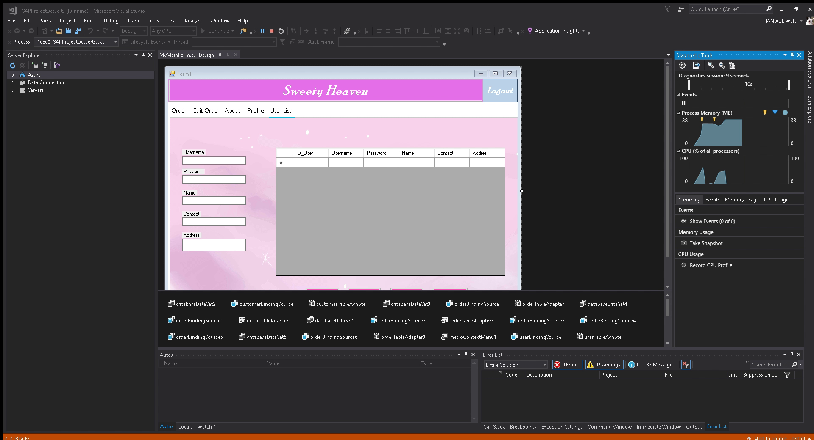

# Dessert Ordering System

A Software Application Project by **Tan Xue Wen**, preserved from the supplied final-submission archive.

A Windows desktop application built with **C#, Windows Forms, SQL Server LocalDB and MetroModernUI**. The solution and namespace retain the original name `SAPProjectDesserts`.

## Original recording

[Watch or download the original demonstration video](https://github.com/hopepx/SAPProjectDesserts/releases/tag/project-demonstration).

The supplied recording is dated July 2020 and captures the original Visual Studio/application session. The screenshot above is an actual frame from that recording. Feature descriptions below come from inspecting the C# source; the recording is not evidence of a fresh build of this repository.

## Features in the source

- Registration, login and a signed-in profile.
- Four dessert choices with product images and prices.
- Quantity selection and order-total calculations.
- An order list with add, update, delete and display controls.
- User-record management and password-change forms.
- Basic field checks, matching-password validation and numeric contact input.

This is a coursework desktop application. It does not include online payment processing or a hosted web version.

## Project structure

- `SAPProjectDesserts.sln` — Visual Studio solution.
- `SAPProjectDesserts/` — C# forms, designers, resources, typed datasets and project configuration.
- `database/Schema.sql` — empty `User` and `Order` tables reconstructed from the final typed dataset, with no saved account or order records.
- `docs/` — an actual frame from the supplied project recording.

## Run locally

1. On Windows, install Visual Studio with **.NET desktop development**, the **.NET Framework 4.6.1 targeting pack**, and SQL Server Express LocalDB.
2. Open `SAPProjectDesserts.sln` and restore the NuGet package `MetroModernUI` version **1.4.0.0** from `packages.config`.
3. In Visual Studio's Server Explorer, create a **new, empty SQL Server database file** named `Database.mdf` inside the `SAPProjectDesserts/` project folder. Use `(LocalDB)\MSSQLLocalDB`.
4. Run `database/Schema.sql` against that new database. The script creates the tables used by the active forms. It should not be run against an existing database containing those tables.
5. Build and run. Register a fictional test account through the application's registration form.

Both direct SQL commands and generated table adapters now use the connection string in `App.config` / `Properties/Settings.settings`. The runtime database path resolves from the application's output directory. Existing database files are copied by the original project build settings; keep backups of local test data before rebuilding.

## Preparation for this repository

The original forms, layout, business logic, generated datasets and product assets are retained. The machine-specific database path in `Program.cs` was replaced with the existing shared settings connection string. The project only copies database files when they exist, so the source can be restored without publishing saved account data.

Visual Studio caches, build output, restored packages, database binaries and user-specific settings are excluded. The SQL schema is newly reconstructed from `DatabaseDataSet7.xsd`; it is not an export of the original database records. Older typed datasets are retained as part of the original project history.

## Scope and verification

The source and project references were inspected, and the public files were checked for missing resources and excluded local data. This application has not been compiled or run in this environment. The supplied recording documents the original submission, rather than a new build of this prepared source.

The original authentication stores passwords as plain text, and some SQL statements concatenate user input. Use fictional data for local study; authentication and database access need hardening before any real deployment. Third-party UI libraries and product images retain their respective rights; no new license is assigned here.
